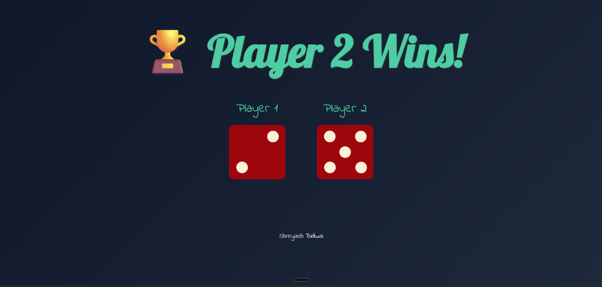

# 🎲 Dice Game

A simple, interactive two-player dice game built with HTML, CSS, and JavaScript. Roll the dice, compare the results, and see which player wins!

## 🚀 Live Demo

**[Play the Dice Game](https://shadowmask86.github.io/dice-game/)**

## 📸 Screenshot



## ✨ Features

- 🎲 Generates a random dice roll from 1 to 6 for each player.
- 🏆 Displays the winner based on the dice values.
- 🤝 Detects and displays a draw when both players roll the same number.
- 🎨 Modern dark gradient background and custom typography.
- ✨ Smooth hover effect on the dice images.
- 📱 Responsive styling for smaller screens.

## 🛠️ Technologies Used

- **HTML5** — Structures the game interface.
- **CSS3** — Styles the layout, background, typography, hover effects, and responsive design.
- **JavaScript** — Generates random dice values, updates dice images, and determines the winner.

## 📂 Project Structure

```text
dice-game/
├── images/
│   ├── dice1.png
│   ├── dice2.png
│   ├── dice3.png
│   ├── dice4.png
│   ├── dice5.png
│   ├── dice6.png
│   └── screenshot.png
├── .gitignore
├── index.html
├── index.js
├── README.md
└── styles.css
```

## 💻 Run Locally

1. Clone the repository:

   ```bash
   git clone https://github.com/ShadowMask86/dice-game.git
   ```

2. Open the project folder:

   ```bash
   cd dice-game
   ```

3. Open `index.html` in your browser, or use the Live Server extension in Visual Studio Code.

## 🎮 How to Play

1. Open the game.
2. The page generates a random dice roll for each player.
3. The dice images update to show the results.
4. The player with the higher number wins.
5. If both players roll the same number, the game ends in a draw.
6. Refresh the page to roll again.

## 👨‍💻 Author

**Shreyash Bidwai**

- GitHub: [@ShadowMask86](https://github.com/ShadowMask86)
- Live Project: [Dice Game](https://shadowmask86.github.io/dice-game/)

---

⭐ If you like this project, consider giving the repository a star!